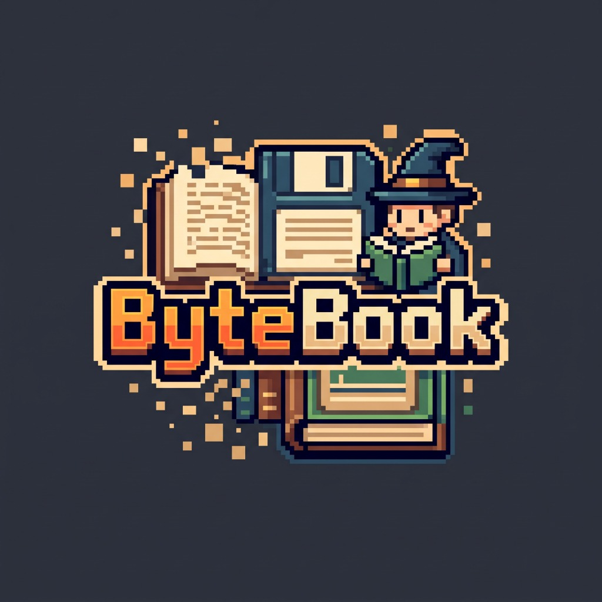

<div align="center">



# 👾 ByteBook (بايت بوك)
### قارئ الكتب التخصصية الذكي بنمط الـ 16-Bit | 16-Bit AI Interactive Verbatim Reader

[](https://expo.dev)
[](https://reactnative.dev)
[](https://www.typescriptlang.org)
[](https://developer.apple.com)
[](LICENSE)

**قارئ كتب متطور يدمج بين سلاسة النصوص المتدفقة (على غرار تطبيق أبجد)، ومحرك الذكاء الاصطناعي السياقي المزدوج، مع هوية بصرية ساحرة مستوحاة من ألعاب الـ 16-Bit RPG.**

[العربية](#-عن-المشروع) • [English](#-about-bytebook) • [الميزات](#-الميزات-الرئيسية) • [طريقة التشغيل](#-التثبيت-والتشغيل) • [المعمارية](#-المعمارية-التقنية)

---

</div>

## 📖 عن المشروع (About ByteBook)

تم تصميم **ByteBook** كحل جذري لعقبة قراءة الكتب والمراجع البرمجية والتقنية الضخمة باللغة الإنجليزية:
- **نص كامل كلمةً بكلمة (Verbatim 100%)**: لا يقوم التطبيق بتلخيص الكتاب أو اختصاره إطلاقاً، بل يعرض كامل النص الأصلي للكتاب مع تنسيقاته وفقراته وعناوينه.
- **نظام الشابتر بشابتر (Progressive Chapter-by-Chapter Engine)**: بالنسبة للكتب الضخمة (1000+ صفحة مثل *Grokking Algorithms*)، يقرأ المحرك الكتاب فصلاً فصلاً (أو كل 10 صفحات) دون إجهاد الذاكرة أو تعليق الجهاز، مع زر "أنهيت الشابتر" لتحليل والانتقال للجزء التالي فوراً.
- **الترجمة السياقية العميقة**: ترجمة فورية للكلمات والجمل بالاعتماد على سياق الفقرة ومجال الكتاب التخصصي (Computer Science, AI, Systems) عبر Google Gemini أو GroqCloud أو المعجم التقني المدمج دون الحاجة لسيرفر خارجي.

---

## ✨ الميزات الرئيسية (Key Features)

### 1. 📚 محرك استيراد وتجزئة الكتب (Chapter-by-Chapter Parsing)
- يدعم استيراد ملفات **EPUB** و **PDF** و **TXT**.
- معالجة ذكية لأخطاء مراجع الـ PDF الدائرية (*Circular References*) مع عزل الصفحات وحفظ النصوص المستخرجة محلياً في SQLite.
- عرض متدفق فائق السرعة عبر `@shopify/flash-list` للتعامل مع آلاف الفقرات بسلاسة 60fps.

### 2. 🤖 الترجمة السياقية المزدوجة (Dual Contextual AI Engine)
- **ترجمة الكلمة في سياقها التخصصي**: بنقرة واحدة، يحلل الذكاء الاصطناعي الجملة والفقرة ومجال الكتاب ليعطي المعنى العلمي الحقيقي للكلمة (وليس المعنى المعجمي الحرفي).
- **ترجمة وشرح الفقرة**: أزرار مدمجة أسفل كل فقرة لترجمة الفقرة كاملة أو شرح وتبسيط المصطلحات العلمية المعقدة.
- **محفظة مفاتيح محلية مشفرة (Secure Key Vault)**: خيار ربط مفاتيح Google Gemini API أو GroqCloud API مجاناً مع تخزين مشفر محلياً عبر `expo-secure-store`.

### 3. 🖼️ الرسوم التوضيحية التفاعلية (Figures Lightbox Modal)
- فصل الصور والمخططات الهندسية عن النص وعرضها كبطاقات منفصلة بعد الفقرة التابعة لها.
- شارات أرقام الصور `[Fig. 1]` تفاعلية؛ النقر عليها يفتح عارضاً فورياً عالي الدقة يدعم التقريب باللمس (Pinch-to-Zoom 100%–300%) مع إمكانية القفز لموقع الصورة في النص والعودة للسطر بضغطة زر.

### 4. 🔊 النطق الصوتي التفاعلي (Full-Spectrum TTS)
- نطق صوتي إنجليزي بشري للمفردات الفردية، الجمل السياقية، والفقرات الكاملة.
- زر إيقاف فوري تفاعلي (`⏹️ إيقاف النطق`) متاح في شريط القارئ العلوي وبجانب كل فقرة.

### 5. 🎴 بنك المفردات وبطاقات المراجعة (Vocabulary Vault & Flashcards)
- حفظ أي كلمة مع نطقها، معناها السياقي، ومعناها المعجمي وسياقها بضغطة زر.
- نمط بطاقات المراجعة التفاعلية (Flashcard Flip Mode) لاختبار وتثبيت الحصيلة اللغوية.

### 6. 📱 دعم PWA كامل للآيفون وشاشات الجوال الصغيرة
- متوافق كلياً كـ **iOS Safari Standalone PWA** مع ميتا تاجات الشاشة الكاملة وإخفاء شريط المتصفح.
- تصميم تجاوبي مرن (Responsive Flexbox) تم اختباره لضمان عدم خروج أي أزرار خارج إطار الشاشة حتى على أصغر هواتف الآيفون (iPhone SE / iPhone 13 mini).

---

## 🎨 الهوية البصرية وأنماط الإضاءة (16-Bit Retro UI)

يوفر التطبيق 4 أنماط إضاءة وألوان بكسلية:
1. **الورق العتيق (Aged Paper)**: ألوان ترابية دافئة مريحة للعينين في القراءة الطويلة.
2. **فوسفور الليل (Night Phosphor)**: وضع ليلي هادئ مقتبس من الشاشات الكلاسيكية الخضراء والداكنة.
3. **سايبر بانك (Cyberpunk Arcade)**: تباين عالي مستوحى من صالات الألعاب القديمة.
4. **غيم بوي كلاسيك (GameBoy Retro)**: إحساس أجهزة الألعاب المحمولة في التسعينات.

مع إمكانية التحكم بحجم الخط وتباعد الأسطر والتبديل بين خط **Literata** المريح وخط **VT323** البكسلي.

---

## 🛠️ البنية التقنية (Tech Stack)

| المجال | التقنيات المستخدمة |
|---|---|
| **بيئة العمل الأساسية** | [Expo SDK 57](https://expo.dev) + [React Native 0.86](https://reactnative.dev) + [React 19](https://react.dev) |
| **التوجيه والتنقل** | [Expo Router](https://docs.expo.dev/router/introduction/) (File-based navigation) |
| **إدارة الحالة** | [Zustand 5](https://github.com/pmndrs/zustand) |
| **قواعد البيانات والتخزين** | [expo-sqlite](https://docs.expo.dev/versions/latest/sdk/sqlite/) (Local DB) + [expo-secure-store](https://docs.expo.dev/versions/latest/sdk/securestore/) |
| **العرض فائق السرعة** | [@shopify/flash-list](https://shopify.github.io/flash-list/) |
| **تحليل الكتب والمستندات** | `pdfjs-dist` (patched with circular fault isolation) + `fflate` (EPUB/ZIP) |
| **النطق والصوتيات** | `expo-speech` + `expo-haptics` |
| **الخطوط البكسلية والعلمية** | PressStart2P, Silkscreen, VT323, Literata, IBM Plex Sans Arabic |

---

## 🚀 التثبيت والتشغيل (Getting Started)

### المتطلبات الأساسية
- تثبيت [Node.js](https://nodejs.org) (الإصدار 18 أو أحدث).
- تثبيت تطبيق **Expo Go** على هاتفك (iOS أو Android) للتجربة الحية.

### خطوات التشغيل المحلي

1. **استنساخ المستودع (Clone repository):**
   ```bash
   git clone https://github.com/osama0511/ByteBook.git
   cd ByteBook
   ```

2. **تثبيت الحزم (Install dependencies):**
   ```bash
   npm install
   ```
   *(يقوم أمر postinstall تلقائياً بتطبيق باتش pdfjs-dist لمنع مشاكل Circular References في ملفات PDF).*

3. **بدء السيرفر المحلي (Start Metro Bundler):**
   ```bash
   npx expo start
   ```

4. **تشغيل نسخة الويب أو اختبار PWA:**
   ```bash
   npx expo start --web
   ```

5. **فحص سلامة الأكواد (Lint & Typecheck):**
   ```bash
   npm run lint
   npx tsc --noEmit
   ```

---

## 🌐 بناء وتصدير نسخة الويب (Web Export for Vercel / GitHub Pages)

لبناء نسخة الويب الثابتة الكاملة (مع حقن تاجات الـ PWA Standalone والأيقونات):
```bash
npm run export:web
```
أو عبر أمر البناء القياسي:
```bash
npm run build
```
سيتم توليد ملفات الموقع كاملة داخل مجلد `dist/` جاهزة للرفع على Vercel أو Cloudflare Pages أو GitHub Pages.

---

## 📁 هيكلة المشروع (Project Architecture)

```
ByteBook/
├── app/                          # شاشات التطبيق (Expo Router)
│   ├── +html.tsx                 # قالب HTML لمتصفح الويب و iOS PWA Standalone
│   ├── _layout.tsx               # التخطيط الجذري والخطوط و SafeAreaProvider
│   ├── index.tsx                 # رف الكتب الرقمي واستيراد الكتب
│   ├── settings.tsx              # خزنة الـ AI ومفاتيح الـ API ومظهر القراءة
│   ├── vocabulary.tsx            # بنك المفردات وبطاقات المراجعة (Flashcards)
│   └── reader/
│       └── [bookId].tsx          # شاشة القارئ المتدفق بنظام الشابتر بشابتر
├── components/
│   ├── pixel-ui/                 # مكوّنات واجهة البكسل (Button, Frame, Badge, Modal, etc.)
│   └── reader/                   # مكوّنات القراءة (InteractiveParagraph, Popover, Lightbox)
├── database/                     # تهيئة جداول SQLite محلياً (Books, Blocks, Figures, Vocab)
├── services/
│   ├── parser/                   # محرك استخراج الكتب وتقسيم الشابترات
│   └── translation/              # محرك الترجمة السياقية المزدوج والنطق الصوتي
├── store/                        # مخازن Zustand (useThemeStore, useReaderStore, useLibraryStore)
├── theme/                        # لوحات ألوان الـ 16-Bit وأنظمة الخطوط والأبعاد
├── public/                       # ملفات PWA (manifest.json, favicon.png)
└── scripts/                      # سكربتات الباتش التلقائي والبناء
```

---

## 📄 الترخيص (License)

هذا المشروع مرخص تحت رخصة **MIT License**.

<div align="center">
صُنع بشغف للقراء والمهندسين 👾📚
</div>
